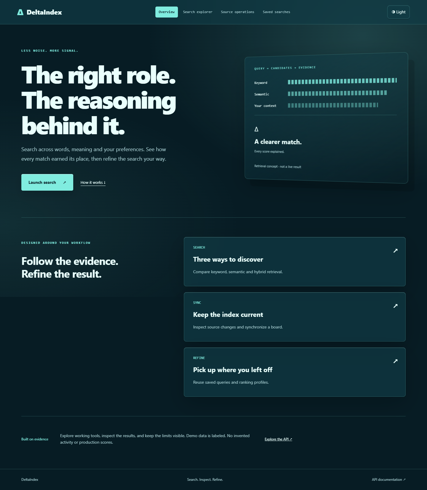
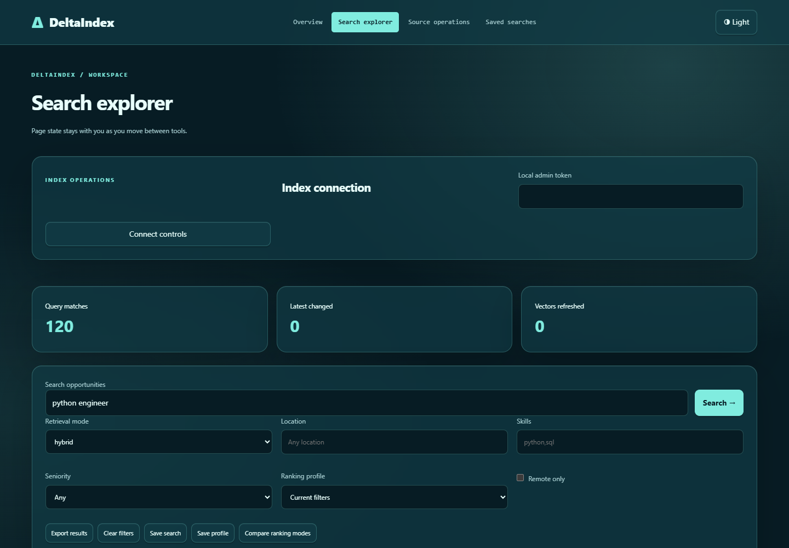
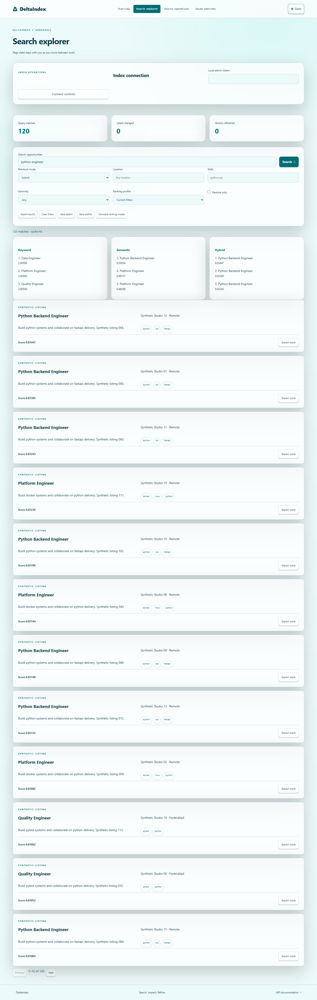
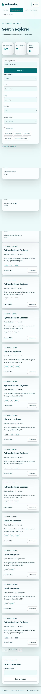
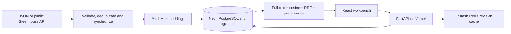
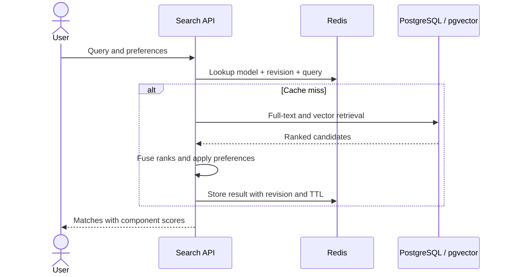

# DeltaIndex

### Hybrid job retrieval with evidence behind every match.

[](https://github.com/Kanishkar843/DeltaIndex-/actions/workflows/checks.yml)

**[Live application ↗](https://deltaindex.vercel.app) · [Interactive API](https://deltaindex.vercel.app/docs) · [Verification report](docs/CLOUD_DELIVERY.md) · [Review PR](https://github.com/Kanishkar843/DeltaIndex-/pull/1)**

DeltaIndex combines semantic vectors, PostgreSQL full-text search and explicit user preferences into an explainable ranking workflow. Incremental ingestion avoids unnecessary embedding work, while revision-aware Redis caching keeps search results aligned with the index.

## Interface redesign

A teal-and-ink search experience with a dedicated landing page, Search explorer, Source operations, and Saved searches. Results use wider evidence rows, with JSON export and clear-filter controls.



## Production preview



Captured from the redesigned application deployed on 25 November 2026. The galleries below show separately captured local test journeys.

<details>
<summary>View light theme and mobile screenshots</summary>

### Light theme — local browser test



### Mobile layout — local browser test



</details>

## Capabilities

- **Real semantic retrieval:** CPU Sentence Transformers locally; pinned, checksum-verified MiniLM ONNX inference on Vercel.
- **Hybrid ranking:** pgvector cosine similarity, PostgreSQL `ts_rank_cd`, reciprocal rank fusion and preference signals.
- **Incremental ingestion:** canonical deduplication, embedding reuse, source tombstones, stale-record handling and retry history.
- **Cache correctness:** model/revision/query cache keys, transactional revision invalidation and a 120-second TTL.
- **Source adapters:** JSON/JSONL and the public Greenhouse GET API; long descriptions are explicitly shortened with original URLs retained.
- **Search workbench:** profiles, saved searches, feedback, score explanations, pagination and responsive themes.

## Scores and verification

**Evidence snapshot: 24 November 2026.** Scores describe the recorded runs, not a live uptime or quality guarantee.

### Cloud retrieval benchmark

Six labeled queries over **120 synthetic jobs**, personalized hybrid retrieval, using quantized MiniLM ONNX + Neon pgvector/full-text search + Upstash Redis.

| Metric | Measured value |
|---|---:|
| Mean Recall@10 | **0.4833** |
| Mean nDCG@10 | **0.9646** |
| Median HTTP round-trip | **492.21 ms** |
| Timed HTTP requests | **18** |
| Embedding dimensions | **384** |
| Unchanged reingestion | **120 unchanged; 0 embeddings recomputed** |

[Raw cloud scores and timings](docs/production-benchmark.json) · [Native benchmark methodology](docs/BENCHMARK.md) · [Raw native results](docs/benchmark-results.json)

The earlier native PyTorch benchmark measured personalized hybrid Recall@10 **0.4833** and nDCG@10 **0.9675**, cached p50 **12.89 ms** / p95 **20.73 ms**, and peak RSS **462.27 MiB**. Native cached timings are not cloud HTTP latency; cloud memory was not measured. This small, templated dataset does not establish production relevance.

A separate live Greenhouse adapter check parsed **633 public postings**, with **83 descriptions explicitly shortened**. Those records were not inserted into the synthetic benchmark.

### Engineering checks

| Check | Verified result |
|---|---|
| Backend unit tests | **12 passed** |
| Frontend unit tests | **2 passed** |
| Real-service integration | **Passed** — PostgreSQL / pgvector / Redis |
| TypeScript / ESLint / production build | **Passed** |
| Browser journeys | **Passed** — local and deployed workflows |
| Docker Compose | **Passed** — build, readiness and restart acceptance |
| Recorded GitHub acceptance run | [**Passed**](https://github.com/Kanishkar843/DeltaIndex-/actions/runs/45410868924) |

[Detailed test evidence](docs/TEST_REPORT.md) · [Cloud checks and limitations](docs/CLOUD_DELIVERY.md) · [Resume-claim verification](docs/RESUME_VERIFICATION.md)

## Architecture





## Run locally

Use Python 3.12 and Node 22 for the documented local workflow. Run one project stack at a time.

```powershell
cd K:\Projects\DeltaIndex
py -3.12 -m venv .venv
.\.venv\Scripts\python.exe -m pip install -r requirements.lock
npm ci --prefix frontend
npm run build --prefix frontend
$env:ADMIN_TOKEN='choose-a-local-secret'
.\.venv\Scripts\python.exe -m uvicorn app.main:app --host 127.0.0.1 --port 8001
```

Open http://127.0.0.1:8001. Enter your operator token, connect controls, ingest the synthetic dataset, search, inspect score evidence and compare ranking modes. Public search can be read without an operator token.

The API serves the compiled React frontend; `/docs` exposes OpenAPI and `/legacy` preserves the original interface. Native defaults use SQLite for an explicit local demo. To use PostgreSQL, configure `DATABASE_URL`, then run `python -m alembic upgrade head`. For frontend development, use `npm run dev --prefix frontend` with the API running.

## Configuration

| Variable | Purpose |
|---|---|
| `DATABASE_URL` | PostgreSQL URL; native default is explicit SQLite demo mode |
| `REDIS_URL` | Dedicated Redis URL; absent uses the native test cache |
| `ADMIN_TOKEN` | Required for mutations and private operator lists |
| `EMBEDDING_MODE` | `fixture`, `sentence-transformers` or `onnx` |
| `MODEL_PATH` / `MODEL_CACHE` | Native Sentence Transformers model path or download cache |
| `ONNX_MODEL_PATH` | ONNX model folder; defaults to `models/minilm` |
| `POSTGRES_PASSWORD` / `APP_PORT` | Compose database secret / loopback port (8001) |

Keep credentials in environment variables or ignored `.env` files. Never put provider keys, database credentials or operator tokens in frontend build variables or Git.

## Deployment

The live frontend and backend share one Vercel project. `vercel.json` builds React, copies assets to `public`, and deploys the FastAPI entrypoint. Neon provides PostgreSQL and Upstash provides Redis; the configured integrations use free plans.

```powershell
# From the linked project, after configuring production secrets and migrations:
vercel deploy --prod --scope kanishkar843s-projects
```

For local containers, configure the required `.env` values, then:

```powershell
docker compose up --build -d --wait
docker compose down
```

Omit `-v` when stopping containers to retain database data. Windows virtual environments cannot be reused inside WSL; use containers or create a Linux environment. See [Windows/Docker setup](docs/DEPLOYMENT.md) and [Vercel configuration](docs/CLOUD_DELIVERY.md).

For native semantic mode, install CPU PyTorch and `requirements-model.txt`, then set `EMBEDDING_MODE=sentence-transformers`. `MODEL_PATH` selects verified local weights; `HF_HUB_OFFLINE=1` supports offline loading. The cloud build uses `EMBEDDING_MODE=onnx`, downloads pinned model files and verifies the model checksum. Default Docker fixture vectors are not semantic inference.

## Reproduce the checks

```powershell
.\.venv\Scripts\python.exe -m pytest -q tests
npm run typecheck --prefix frontend
npm run lint --prefix frontend
npm test --prefix frontend
npm run build --prefix frontend
.\.venv\Scripts\python.exe -m pytest -q integration
.\.venv\Scripts\python.exe tests/browser_journey.py
```

The integration suite requires an isolated real PostgreSQL `TEST_DATABASE_URL` and `TEST_REDIS_URL`; it never substitutes SQLite. The local browser harness owns a temporary fixture server. Production browser evidence is recorded separately in the cloud report.

## Known limits

- The deployed index contains labeled synthetic jobs; live-source adapter verification does not imply an always-current feed.
- Unattended public-source synchronization has not been exercised in the cloud.
- Native PyTorch and deployed quantized ONNX have separate model IDs and caches; quality equivalence is not assumed.
- Native and default Docker fixture mode uses deterministic hash vectors, not semantic inference.
- Operator authorization uses a shared bearer secret; this is not a multi-tenant identity system.

## Documentation and provenance

[Architecture](docs/ARCHITECTURE.md) · [Database schema](docs/DATABASE_ERD.md) · [API reference](docs/API_REFERENCE.md) · [Environment](docs/ENVIRONMENT_REPORT.md) · [Security](docs/SECURITY.md) · [Dependencies and attribution](docs/DEPENDENCIES_AND_ATTRIBUTION.md) · [Original specification](docs/MASTER_PROMPT.md)

First-party application code, interface designs and fixtures are original to this project. Dependencies and model artifacts retain their third-party notices. No first-party project license has been selected.

Development is published on `feat/verified-hybrid-react` through [PR #1](https://github.com/Kanishkar843/DeltaIndex-/pull/1), preserving existing `main` history. Deployment status, software acceptance and evaluated-model quality are reported separately.

[Frontend redesign and verification](docs/FRONTEND_REDESIGN.md)
