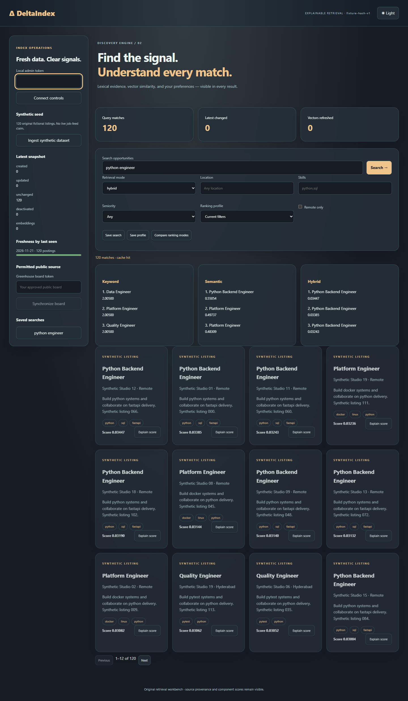
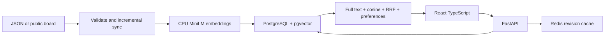

# DeltaIndex

An original job-search workbench with incremental ingestion, PostgreSQL full-text search, pgvector cosine retrieval, reciprocal-rank fusion, explainable preference ranking and Redis invalidation.

**Verified locally:** real CPU Sentence Transformers inference, PostgreSQL 17.12/pgvector 0.8.7, Redis 8.10.3, 11 backend tests, real-service integration, React/TypeScript checks and browser journeys. Docker startup/restart acceptance also passed; feature-branch delivery is in progress. Synthetic listings are labeled throughout; no production traffic or live-feed availability is claimed.



## Windows quickstart

Use Python 3.12 and Node 22. Run only one project stack at a time.

```powershell
cd K:\Projects\DeltaIndex
py -3.12 -m venv .venv
.\.venv\Scripts\python.exe -m pip install -r requirements.lock
npm ci --prefix frontend
npm run build --prefix frontend
$env:ADMIN_TOKEN='choose-a-local-secret'
.\.venv\Scripts\python.exe -m uvicorn app.main:app --host 127.0.0.1 --port 8001
```

Open http://127.0.0.1:8001. Enter your token, connect controls, ingest the 120 fictional listings, search, inspect score evidence, and compare ranking modes. Native default mode explicitly uses SQLite and deterministic hash vectors. `/legacy` retains the original interface. `/docs` contains generated API contracts.

For real services, set DATABASE_URL to PostgreSQL, REDIS_URL to a dedicated Redis database, and run `python -m alembic upgrade head`. Install CPU torch from its official CPU index and `requirements-model.txt`, then set EMBEDDING_MODE=sentence-transformers. Initial model loading needs network access; MODEL_PATH selects verified local weights and supports HF_HUB_OFFLINE=1. See [deployment](docs/DEPLOYMENT.md) and [benchmark](docs/BENCHMARK.md).

## What is implemented

- JSON/JSONL and bounded read-only Greenhouse Job Board adapters; scheduler and manual synchronization.
- Atomic upserts, canonical cross-source deduplication, textual embedding reuse, source tombstones, last-seen expiration and failure history.
- Real PostgreSQL `ts_rank_cd` and pgvector cosine ranking, deterministic RRF, metadata filters and weighted skills/remote/location/freshness/seniority preferences.
- Redis model/revision/query keys with 120-second TTL and transactional revision invalidation.
- React dashboards, profiles, saved searches, feedback, pagination, score explanations, freshness display, dark/light themes and mobile layout.



## Executed quality checks

```powershell
.\.venv\Scripts\python.exe -m pytest -q tests
.\.venv\Scripts\python.exe -m pytest -q integration
npm run typecheck --prefix frontend
npm run lint --prefix frontend
npm test --prefix frontend
npm run build --prefix frontend
.\.venv\Scripts\python.exe tests/browser_journey.py
```

Integration requires explicit TEST_DATABASE_URL and TEST_REDIS_URL pointing at isolated real services; it never substitutes SQLite. The browser test owns a temporary SQLite fixture server and is separately labeled. Detailed evidence and past failures: [test report](docs/TEST_REPORT.md).

The six-case real-model synthetic benchmark measured hybrid mean Recall@10 .2833 → .4833 and nDCG@10 .5631 → .9675 with personalization. This tiny templated benchmark is not evidence of production relevance. [Raw results](docs/benchmark-results.json) include query-level metrics and latency samples.

## Environment

| Variable | Purpose |
|---|---|
| DATABASE_URL | SQLAlchemy PostgreSQL URL; default explicit SQLite demo |
| REDIS_URL | Dedicated Redis database URL; absent uses native test cache |
| ADMIN_TOKEN | Required for mutations and private operator lists |
| EMBEDDING_MODE | fixture or sentence-transformers |
| MODEL_PATH | Optional local verified MiniLM folder |
| MODEL_CACHE | Download cache directory |
| POSTGRES_PASSWORD | Required Compose database secret |
| APP_PORT | Compose loopback host port, default 8001 |

```powershell
docker compose up --build -d --wait
docker compose down
```

Do not use `down -v` if you want to retain data. Docker defaults to the explicitly labeled fixture embedding mode; the optional model image is described separately. Secrets belong in environment variables or ignored `.env` files, never Git. This is a single-operator local tool, not a multi-tenant identity service. Public search results are readable; operator writes require constant-time bearer verification.

[Architecture](docs/ARCHITECTURE.md) · [Schema](docs/DATABASE_ERD.md) · [API](docs/API_REFERENCE.md) · [Ingestion](docs/INGESTION_LIFECYCLE.md) · [Retrieval](docs/RETRIEVAL_DESIGN.md) · [Resume verification](docs/RESUME_VERIFICATION.md) · [Attribution](docs/DEPENDENCIES_AND_ATTRIBUTION.md)

Target: https://github.com/Kanishkar843/DeltaIndex-. Existing remote history will be preserved through a feature branch. No completed release is currently published. First-party implementation is original; no project license is assigned without the owner's choice. Third-party notices remain with dependencies.
