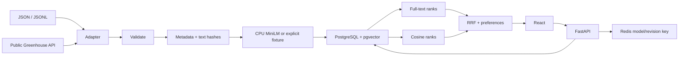

# DeltaIndex architecture

React/TypeScript is built by Vite and served on the FastAPI origin. The API supports an explicit SQLite/hash-fixture demo and a verified PostgreSQL/pgvector/Redis/CPU-MiniLM path. A bounded synchronous ingestion transaction prioritizes atomic snapshots and small-machine operation over large-scale ingestion throughput. PostgreSQL writers serialize on the revision row; the scheduler is intended as one operator process, not a distributed work queue.

Source map: main.py handles validated API/auth; store.py owns transactional indexing, retrieval and cache; core.py owns typed postings, embedding selection and scoring; adapters.py validates public/local inputs; cli.py runs ingestion and scheduling. Frozen Alembic revisions are authoritative for deployed schemas. tests/ contains deterministic tests; integration/ requires real PostgreSQL/Redis. app/benchmark.py measures the explicitly configured real-service path.

Tradeoffs: exact retrieval scans candidates and is appropriate for the small corpus; HNSW indexes exist but no ANN speedup is claimed. Metadata is stored as typed serialized payload plus normalized lifecycle entities. Cache invalidation is revision-based with 120-second TTL. Operator authentication is a shared local bearer secret; this is not a multi-tenant product. HTTP/model failures surface explicitly; no simulated live results are substituted.
