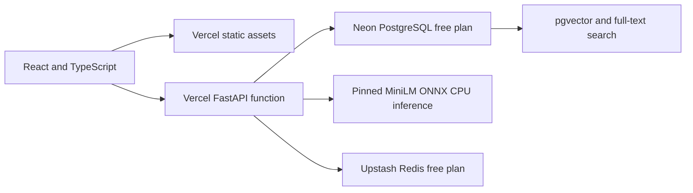

# Cloud delivery — 2026-11-24

Live application: https://deltaindex.vercel.app

Production uses checksum-verified quantized MiniLM ONNX inference (384 dimensions), Neon PostgreSQL/pgvector full-text and similarity search, reciprocal rank fusion, and Upstash Redis. The native Sentence Transformers implementation remains available. Production is seeded with 120 explicitly synthetic jobs.

## Architecture



## Verified evidence

- Health/readiness: HTTP 200, actual ONNX MiniLM, PostgreSQL and Redis.
- First ingestion: 120 created, 120 embeddings. Reingestion: 120 unchanged, zero embeddings.
- Public hybrid retrieval and browser score explanation: passed.
- Backend: 12 tests passed; correctness lint passed. Actual ONNX check: dimensions, finite normalized values, repeatability and semantic ordering passed.
- Three-sentence ONNX/PyTorch cosine comparison: 0.994441, 0.992294, 0.992147. This small check does not establish quality equivalence.
- Six labeled synthetic queries, personalized hybrid retrieval: mean Recall@10 0.483333, nDCG@10 0.964629; median HTTP round-trip 492.2134 ms across 18 requests. Network and serverless startup affect this measurement. Cloud RSS was not measured. See production-benchmark.json for raw samples; earlier native benchmark remains separate.
- Native Sentence Transformers uses PyTorch; Vercel uses ONNX Runtime 1.32.0 and quantized weights from the same pinned model revision. Their model IDs differ to prevent mixing embedding caches.
- Live Greenhouse public GET adapter: 633 non-synthetic Anthropic postings parsed successfully; 83 descriptions were explicitly shortened to the 10,000-character storage limit while retaining original URLs. No live records were ingested into the benchmark/demo database. The first attempt failed on oversized descriptions; a regression test and bounded normalization fixed it. Scheduled live synchronization remains unverified.

All three applications passed actual Chrome production smoke journeys. Screenshots in docs/assets/production-desktop.png were captured from live deployments with secret fields cleared. Earlier local/Docker/CI evidence remains in TEST_REPORT.md; those checks are not relabeled as cloud checks.

The initial production browser harness expected DeltaIndex search results before submitting a query; this assertion failed. The harness now submits Search, and the rerun passed. Initial Vercel builds required flattening requirements.txt rather than including the runtime lock with -r.

## Reproduce deployment

Use Node, Python 3.12, authenticated Vercel CLI and the existing linked project. Never commit .env files or .vercel metadata.

```powershell
npm ci --prefix frontend
npm run build --prefix frontend
# Apply Alembic against the selected PostgreSQL database before deploying.
.\.venv\Scripts\python.exe -m alembic upgrade head
vercel deploy --prod --scope kanishkar843s-projects
```

vercel.json builds React and copies static assets into public; app/main.py is the FastAPI entrypoint. DATABASE_URL accepts Neon postgres/postgresql URLs and selects the psycopg driver. requirements.txt pins cloud runtime dependencies; requirements.lock retains native development dependencies.

Neon resources use free_v3; Upstash uses free with automatic paid upgrade disabled. No paid plan was enabled. Provider and database credentials remain in Vercel environment variables and ignored local files. Account quota availability is not a performance guarantee.

## Access and limitations

Administrative controls require ADMIN_TOKEN. The owner can retrieve the local value from the ignored .env.production.local file; never publish that token or put it in frontend build variables. This is a single-operator workspace, not multi-tenant account authentication.

