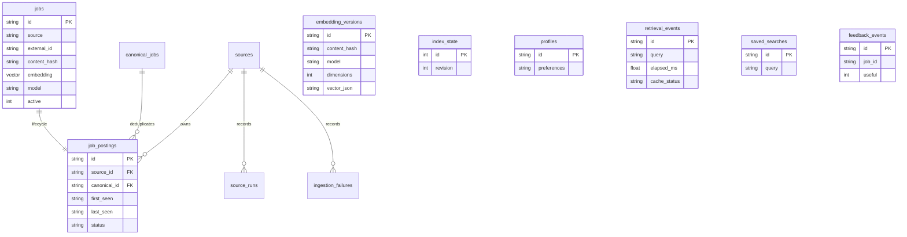

# Database schema

Alembic 0001 freezes jobs/source_runs/index_state/saved_searches/feedback_events. Revision 0002 adds lifecycle, profiles, embedding versions and retrieval/failure evidence. PostgreSQL enables vector and dimension-specific indexes; native SQLite stores fixture vectors as JSON text.

Source-run/failure links are logical source IDs; posting source/canonical/job links are enforced foreign keys. `(source,external_id)` and `(embedding text hash,model)` are unique. UTC ISO timestamps track lifecycle. Embedding text hashes exclude salary/URL metadata. The singleton revision row locks concurrent PostgreSQL ingestion and expires prior cache namespaces without deleting unrelated Redis data. Existing initial datasets acquire posting lifecycle entries when reingested.
