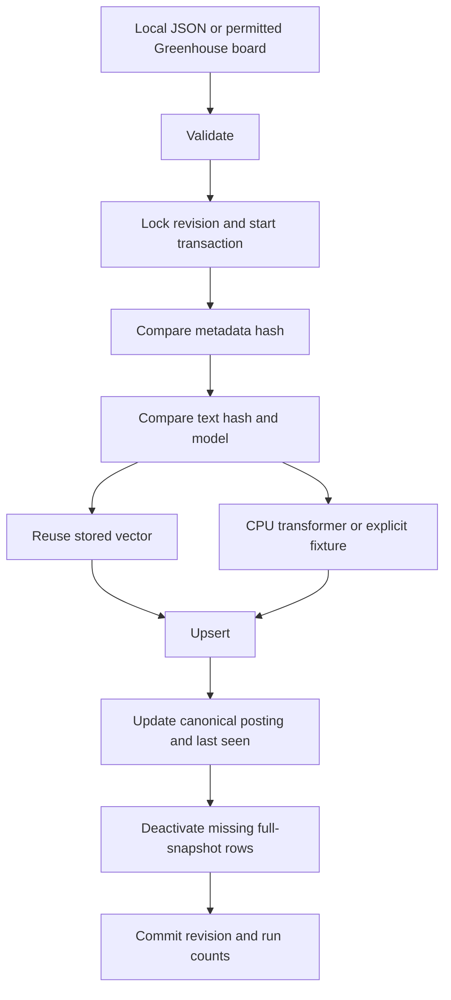

# Incremental ingestion

Validate the full batch before entering a transaction. Reject duplicate external IDs within a source snapshot. Stable posting identity hashes source plus external ID. Metadata content hashes detect updates; separate embedding hashes cover only textual fields, so salary/URL changes reuse embeddings. Embedding model version participates in reuse. Cross-source canonical identity uses normalized employer/title/location/description and preserves each source posting's provenance.

PostgreSQL writers lock the revision row. Sources, postings, embeddings, last-seen history, tombstones, revision, and run counts commit atomically. Full snapshots deactivate missing postings; incremental batches preserve them. Explicit stale expiration uses last-seen cutoff and the same revision lock. A failed source fetch records its error type and leaves existing jobs active. The CLI supports JSON/JSONL ingestion, expiration and scheduled due-source polling.

The Greenhouse adapter uses the documented read-only Job Board API (`GET /v1/boards/{board}/jobs?content=true`). Only alphanumeric/underscore/hyphen board tokens are accepted; redirects are disabled, TLS is verified, and requests retry at most three times with bounded backoff. It never submits applications or accesses authenticated candidate data. Configure a board you are permitted to reuse and honor its content terms. Public API documentation: https://docs.greenhouse.io/job-board.html (checked 2026-11-22). Mock transport retry tests do not establish live-feed availability.

