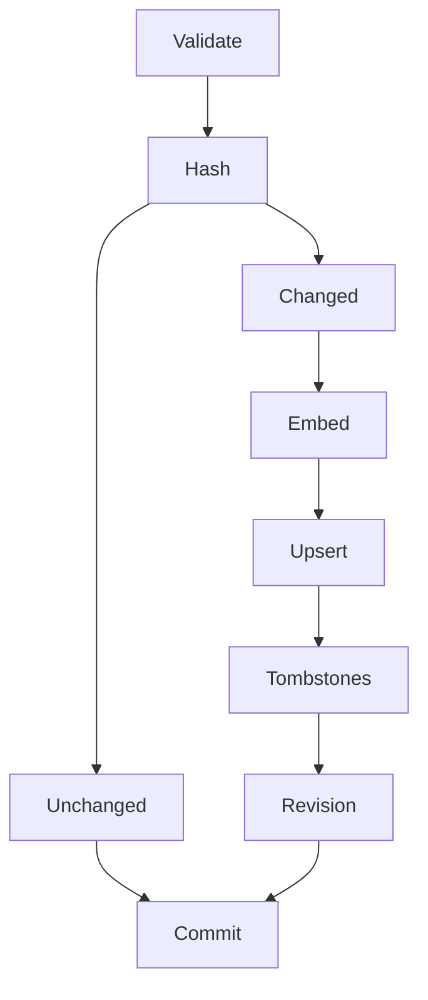

# Ingestion lifecycle

Validate the entire batch first, reject repeated source IDs, then enter one transaction. Identity is SHA-256(source + separator + external_id). Content hashes cover normalized JSON fields except external_id. A changed content hash or embedding model version triggers regeneration. Unchanged active records avoid embedding work. A full snapshot deactivates source rows absent from the validated batch; incremental batches do not delete missing IDs. Revision and source-run counts commit with job changes.

Native tests verify 120 initial inserts, zero embeddings on reingest, one refresh after one edit, one deactivation and an atomic invalid-batch rejection. Cross-source canonical dedup, stale last_seen tracking, remote-source outages and scheduler retries remain pending.
