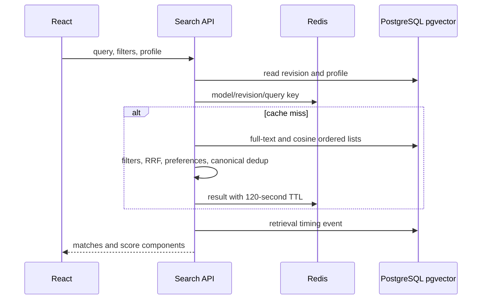

# Retrieval and personalization

PostgreSQL uses English `to_tsvector`, `plainto_tsquery`, and `ts_rank_cd`; this is not BM25. pgvector computes cosine similarity. Hybrid reciprocal-rank fusion sums `1/(k+rank)` (default k=60). Location and remote filters apply to both ordered lists before fusion. Canonical duplicates are removed after score ordering. Scores expose lexical/vector ranks, base score, and each preference contribution.

Preferences are requested-skill coverage (default weight .02), requested remote/location/seniority matches (.01 each), and linear 30-day freshness (.005). Profile weights are validated within [0,1]. Keyword/vector base-score scales differ from RRF, so the same preference weights have different relative effects in each mode; inspect the measured personalized benchmark rather than assuming comparable calibration.

The real CPU model is `sentence-transformers/all-MiniLM-L6-v2`, 384 normalized dimensions. Explicit fixture mode uses 64-dimensional deterministic hashes and token overlap under SQLite. Fixture results are not semantic inference. PostgreSQL always uses real full-text SQL and pgvector operators, even when vectors are fixtures.

Indexes include GIN full-text, source/active B-tree, and partial dimension-specific HNSW indexes. Current exact ranking reads the candidate corpus; no ANN speedup or large-corpus scaling claim is made. A future bounded SQL candidate stage should be evaluated before scaling beyond the portfolio dataset.

Redis keys include embedding model, database revision and normalized query/filter/weight/pagination inputs. Writes increment revision in the same transaction as content/tombstones. Old keys expire after 120 seconds; no global flush is used. A concurrent read may see the preceding committed snapshot; no stale entry is reachable under a newer revision. Freshness scores can age within the TTL. Cache hits still write a measured retrieval event. Service failures surface rather than return fabricated data.

