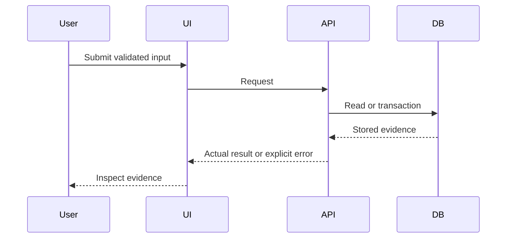

# Workflows

1. 120 original, visibly synthetic postings.
2. Validated snapshots, content hashes, idempotent upsert, deactivation and model-version refresh.
3. PostgreSQL full-text/pgvector query paths and Redis revision-key cache implementation.
4. Native SQLite/hash-vector test mode with deterministic rank fusion.
5. Search filters, score explanations, saved searches and ranking-mode comparison.

The full acceptance workflow remains in MASTER_PROMPT.md. A native success does not establish Docker, cloud or provider success.
